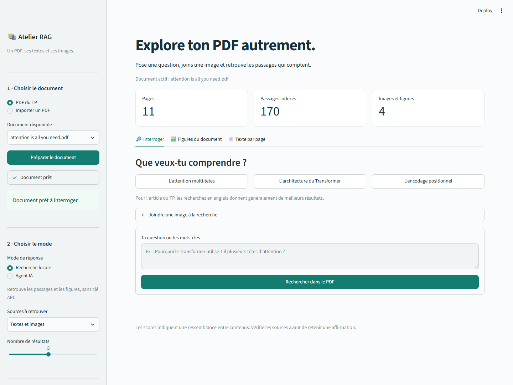
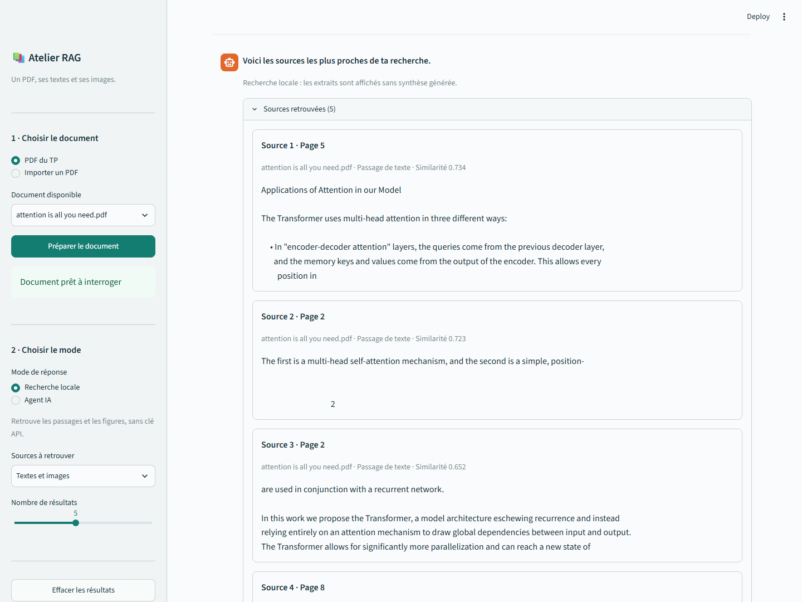
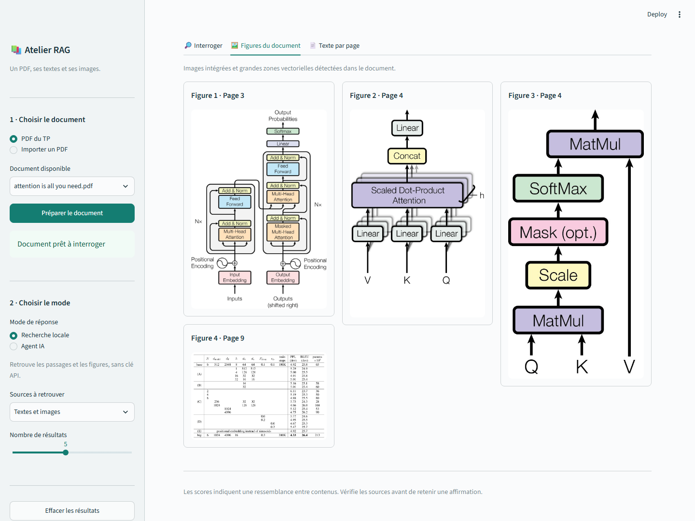
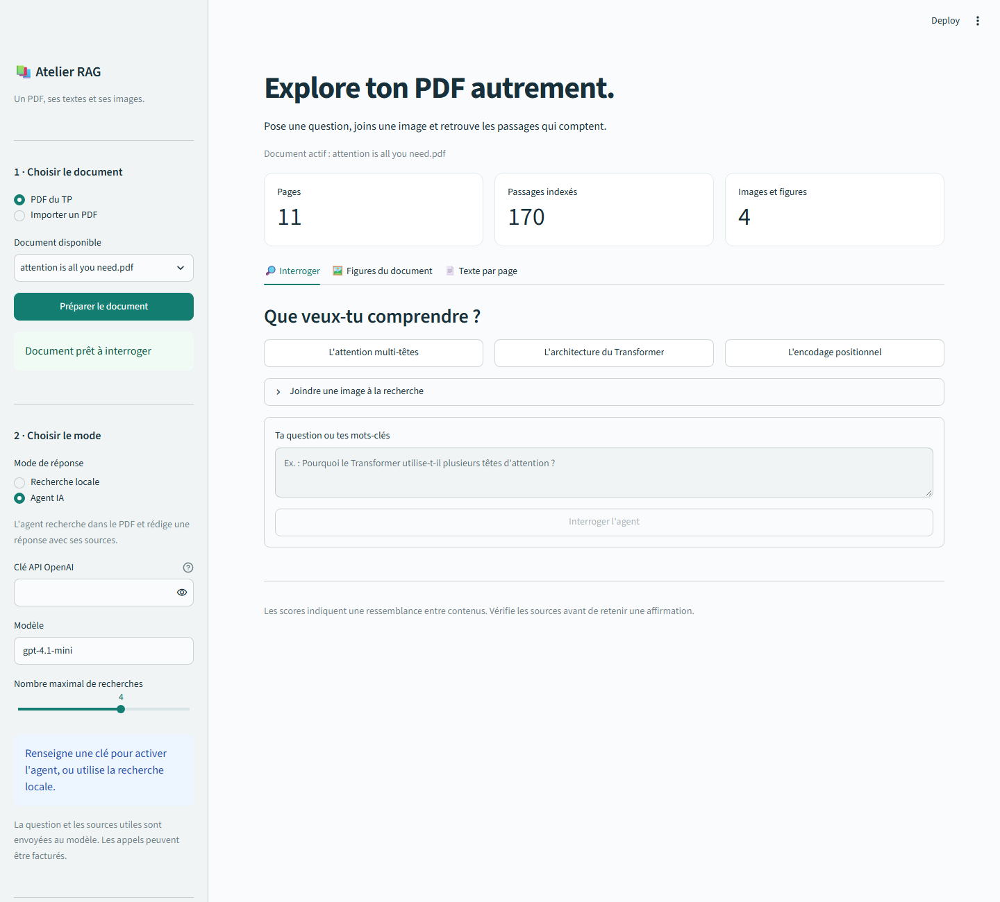
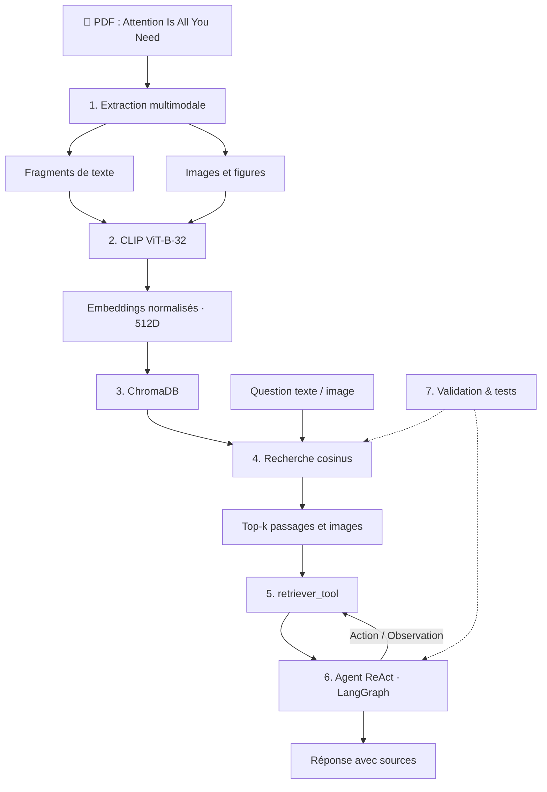
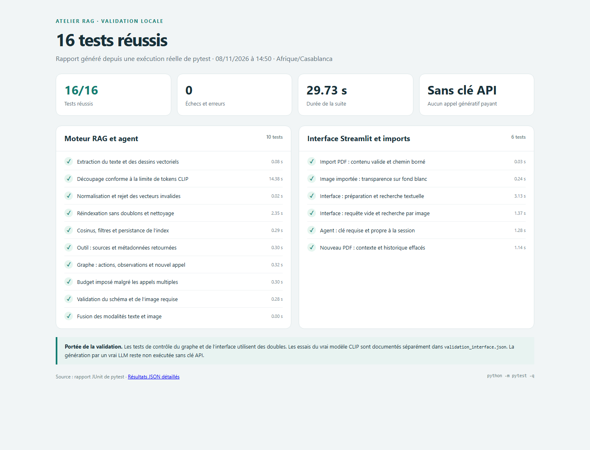

<div align="center">

# 🛠️ ASSISTANT INTELLIGENT MULTIMODAL POUR LA MAINTENANCE INDUSTRIELLE

### RAG agentique multimodal : interroger la documentation technique (texte, schémas, images) avec un agent IA

**Projet de mémoire · PyTorch / CLIP / ChromaDB / LangGraph / Streamlit**

<p>
  
  
  
  
  
  
</p>

**Du PDF brut à une recherche multimodale intelligente : extraire, encoder, indexer, retrouver et raisonner.**

[Contexte du mémoire](#-contexte-du-mémoire) · [Application](#-application-en-action) · [Architecture](#-architecture-du-système) · [Résultats](#-résultats-et-validation) · [Installation](#-installation-et-lancement) · [Feuille de route](#-feuille-de-route-du-mémoire)

</div>

---

## 🎓 Contexte du mémoire

**Sujet :** *Conception et développement d'un assistant intelligent multimodal basé sur le RAG agentique pour l'assistance à la maintenance des équipements industriels.*

**Auteur :** Fidèle Miakanda, étudiant en génie informatique, intelligence artificielle et innovation.

**Problématique.** Les techniciens de maintenance doivent retrouver rapidement une information dans une documentation volumineuse et hétérogène : manuels constructeur, procédures, schémas, photos d'équipements, historiques d'interventions. Une recherche par mots-clés ne suffit pas, car l'information utile se trouve souvent dans un schéma ou à la jonction du texte et de l'image.

**Objectif.** Concevoir un assistant capable de :
- indexer la documentation technique sous forme **multimodale** (texte et images) ;
- répondre à une question, à une photo de composant, ou aux deux combinés ;
- raisonner en plusieurs étapes grâce à un **agent** (pattern ReAct) qui décide quand et comment interroger la base documentaire ;
- **citer ses sources** (document, page, figure) afin que le technicien puisse vérifier.

**État d'avancement.** Ce dépôt contient un **prototype initial** : le pipeline RAG multimodal et agentique est fonctionnel, mais il est pour l'instant démontré sur un document générique (article *Attention Is All You Need*). L'adaptation au domaine de la maintenance industrielle est décrite dans la [feuille de route](#-feuille-de-route-du-mémoire) et constitue le travail du mémoire.

---

## 🌟 Présentation

Ce projet consiste à concevoir une application **RAG (Retrieval-Augmented Generation) multimodale et agentique** capable d'exploiter simultanément le texte et les images d'un document PDF.

Le document de démonstration du prototype est l'article scientifique **_Attention Is All You Need_**, à l'origine de l'architecture Transformer. Il sert de banc d'essai technique avant le passage à des documents de maintenance industrielle.

L'application transforme le PDF en une base documentaire interrogeable : le texte est découpé en fragments, les images et figures sont extraites, puis les deux modalités sont représentées dans un **espace vectoriel commun grâce à CLIP**. Une recherche par similarité retrouve les éléments les plus pertinents. En mode agent, un LLM orchestre ces recherches à l'aide d'un outil documentaire intégré dans un graphe LangGraph.

> **L'objectif :** dépasser une recherche textuelle classique et permettre à un système de retrouver des informations à partir d'une question, d'une image ou d'une requête combinant les deux.

## ✨ Points forts du projet

| Capacité | Résultat / Implémentation |
|---|---|
| Extraction documentaire | **11 pages** analysées |
| Fragments textuels | **170 passages** |
| Contenu visuel | **4 images / figures** |
| Index multimodal | **174 éléments** indexés |
| Embeddings | **CLIP ViT-B-32 · 512 dimensions** |
| Recherche | Texte, image et requête hybride |
| Stockage vectoriel | ChromaDB avec similarité cosinus |
| Identité documentaire | Empreinte SHA-256 |
| Agent | Pattern ReAct avec LangGraph |
| Interface | Application interactive Streamlit |
| Tests automatisés | **16 tests réussis** |

Les chiffres correspondent aux résultats de validation fournis avec le projet. La génération finale par un véritable LLM n'a pas été exécutée lors de cette validation, car aucune clé API n'était configurée.

---

## 🖥️ Application en action



L'interface permet de préparer un document, de choisir le mode de recherche et d'explorer les sources récupérées.

### Recherche textuelle



Les résultats présentent les extraits correspondants, leur page d'origine et leur score de similarité.

### Exploration des figures



Les images intégrées et les zones vectorielles détectées deviennent elles aussi des éléments indexables et consultables.

### Configuration de l'agent



Le mode agent permet de configurer le modèle, la clé API et le nombre maximal de recherches. Cette capture illustre la configuration de l'agent, **pas une réponse générée par un LLM réel**.

---

## 🏗️ Architecture du système

Le pipeline du prototype suit sept étapes.



### Les sept étapes réalisées

| Étape | Composant | Rôle |
|---|---|---|
| 01 | Extraction PDF | Extraire le texte page par page, les images intégrées et les grandes zones vectorielles |
| 02 | CLIP | Encoder texte et images dans un espace latent commun de 512 dimensions |
| 03 | ChromaDB | Stocker les vecteurs et leurs métadonnées, avec une identité SHA-256 du PDF |
| 04 | Retriever multimodal | Rechercher par texte, image ou combinaison des deux |
| 05 | `retriever_tool` | Exposer la recherche comme outil appelable par un agent |
| 06 | LangGraph / ReAct | Orchestrer les cycles de raisonnement, d'action et d'observation |
| 07 | Tests | Vérifier extraction, indexation, retrieval, outil, agent simulé et interface |

## 🔬 Détails techniques

### 1. Extraction du contenu PDF

Le document est traité page par page. Le pipeline sauvegarde :
- le texte intégral de chaque page ;
- les images intégrées au PDF ;
- les grands schémas vectoriels rendus en PNG ;
- un manifeste reliant les éléments à leur page et au document source.

Une empreinte **SHA-256** identifie le PDF et permet de gérer les réindexations. L'extraction ne réalise pas d'OCR : les pages sans couche texte sont signalées.

### 2. Espace multimodal avec CLIP

Le modèle **CLIP ViT-B-32** encode les textes et les images dans un espace commun de **512 dimensions**.

- Les textes sont découpés en fragments compatibles avec la limite de tokens de CLIP.
- Les images sont prétraitées avec le pipeline du modèle.
- Les vecteurs sont normalisés en norme L2.
- Les requêtes textuelles, visuelles ou mixtes peuvent être encodées.

Pour un vecteur \(v\), la normalisation est :

\[
\hat{v} = \frac{v}{\|v\|_2}
\]

La recherche utilise la similarité cosinus, équivalente au produit scalaire pour des vecteurs normalisés.

### 3. Indexation vectorielle

ChromaDB conserve les embeddings et les métadonnées utiles à la restitution :
- type de contenu (`texte` ou `image`) ;
- numéro de page ;
- nom du PDF ;
- identifiant du document ;
- chemin de la source ou contenu textuel.

La réindexation d'un document ne doit pas créer de doublons.

### 4. Recherche multimodale

Le retriever accepte :
- une question textuelle ;
- une image fournie par l'utilisateur ;
- une requête hybride texte + image.

Les résultats sont classés par similarité et peuvent être filtrés par modalité. L'application restitue les passages, les aperçus d'images, les pages et les scores.

### 5. Agent IA — Pattern ReAct

Le retriever est encapsulé dans un outil nommé `retriever_tool`.

L'agent suit le cycle :

```text
       MIND — LLM
           |
         Action
           |
           v
    BODY — retriever_tool
           |
       Recherche CLIP
           |
       Observation
           |
           v
       MIND — LLM
           |
    Nouvelle recherche
       ou réponse finale
```

Le graphe LangGraph relie explicitement les étapes `mind` et `body`. Un budget maximal d'appels à l'outil limite les recherches successives.

**Important sur la validation :** les tests vérifient le cycle agentique avec un modèle simulé déterministe. Le comportement de génération avec un vrai LLM nécessite une clé API et doit être testé séparément.

---

## 📊 Résultats et validation

### Résumé de l'indexation

<details>
<summary><strong>Afficher les résultats de l'extraction et de l'indexation</strong></summary>

| Indicateur | Valeur |
|---|---:|
| Pages PDF | 11 |
| Fragments de texte | 170 |
| Images / figures | 4 |
| Total des éléments indexés | 174 |
| Dimension CLIP | 512 |
| Réindexation sans doublons | Oui |

Source : [`validation.json`](validation.json).

</details>

### Tests de recherche annotés

Les quatre requêtes de contrôle retrouvent au moins une page attendue dans le Top-5.

| Requête de validation | Pages attendues | Pages retrouvées dans le Top-5 |
|---|---|---|
| Attention multi-têtes | 4, 5 | 2, 4, 8 |
| Division par racine de \(d_k\) | 4 | 3, 4 |
| Encodage positionnel | 6 | 5, 6 |
| Architecture encodeur-décodeur | 3 | 2, 3, 5 |

**Hit@5 : 1,00 (4/4)** sur ce petit jeu de requêtes annotées. Ce résultat constitue une validation ciblée, pas une mesure exhaustive de la qualité du retrieval.

Détails : [`validation_retrieval.json`](validation_retrieval.json).

### Tests automatisés



<details>
<summary><strong>Détail des 16 tests réussis</strong></summary>

| Suite | Tests | Vérifications principales |
|---|---:|---|
| `tests/test_tp.py` | 10 | Extraction PDF, découpage CLIP, normalisation, indexation, dédoublonnage, recherche, persistance, outil et cycle agent |
| `tests/test_interface.py` | 6 | Import PDF/image, sécurité des chemins, parcours Streamlit, recherche image seule, gestion de clé API et changement de document |
| **Total** | **16** | **16 réussis · 0 échec** |

Les tests de l'agent utilisent un double de test : ils valident le flux d'exécution sans prétendre mesurer le raisonnement d'un vrai LLM.

Rapport : [`rapport-tests.html`](docs/test-results/rapport-tests.html) · [`resultats.json`](docs/test-results/resultats.json).

</details>

### Validation réelle de l'interface et de CLIP

| Contrôle | Résultat |
|---|---|
| Préparation du PDF dans Streamlit | Réussie |
| Recherche textuelle avec CLIP | Réussie |
| Recherche à partir d'une image connue | Réussie |
| Similarité cosinus image connue | 1,000 |
| Source et page affichées | Réussies |
| Génération réelle avec LLM | Non exécutée pendant la validation |

Source : [`validation_interface.json`](validation_interface.json).

---

## 🧰 Stack technique

| Technologie | Utilisation |
|---|---|
| Python 3.11 / 3.12 | Langage principal |
| PyTorch | Exécution du modèle CLIP |
| OpenCLIP | Embeddings texte et image |
| ChromaDB | Base de données vectorielle |
| LangGraph | Graphe d'exécution agentique |
| LangChain | Outil de retrieval et intégration LLM |
| Streamlit | Interface utilisateur |
| PyMuPDF | Extraction PDF |
| Pillow | Traitement des images |
| NumPy | Calcul et normalisation vectorielle |
| pytest | Tests automatisés |

---

## ⚙️ Installation et lancement

### Prérequis

- Python **3.11 ou 3.12**
- Git
- Connexion Internet pour installer les dépendances et télécharger les poids CLIP au premier lancement
- VS Code (recommandé)

### 1. Cloner le dépôt

```bash
git clone https://github.com/sefimiakanda/RAG-Multi-Modal-Agentique.git
cd RAG-Multi-Modal-Agentique
```

### 2. Créer l'environnement

**Windows — PowerShell**

```powershell
python -m venv .venv
.\.venv\Scripts\python.exe -m pip install --upgrade pip
.\.venv\Scripts\python.exe -m pip install torch torchvision --index-url https://download.pytorch.org/whl/cpu
.\.venv\Scripts\python.exe -m pip install -r requirements.txt
```

**Linux / macOS**

```bash
python3 -m venv .venv
source .venv/bin/activate
python -m pip install --upgrade pip
python -m pip install -r requirements.txt
```

Les versions de l'environnement de validation sont consignées dans [`requirements-lock.txt`](requirements-lock.txt). Pour CUDA, installer les roues PyTorch correspondant à la configuration GPU avant les autres dépendances.

### 3. Lancer l'application Streamlit

**Windows**

```powershell
.\.venv\Scripts\python.exe -m streamlit run app.py --server.port 8502
```

**Linux / macOS**

```bash
python -m streamlit run app.py --server.port 8502
```

Puis ouvrir : **http://127.0.0.1:8502**

Le premier chargement de CLIP peut prendre quelques minutes. Les poids sont ensuite conservés dans le cache local.

### 4. Utiliser l'application

1. Sélectionner le PDF du TP ou importer un autre document.
2. Cliquer sur **Préparer le document**.
3. Attendre la fin de l'extraction et de l'indexation.
4. Choisir **Recherche locale** ou **Agent IA**.
5. Saisir une question, joindre une image ou combiner les deux.
6. Examiner les passages, les figures, les pages et les scores retrouvés.
7. En mode agent, consulter également la trace des actions.

### 5. Activer le vrai LLM

Le mode **Recherche locale** fonctionne sans clé API. Pour générer des réponses avec l'agent, fournir une clé OpenAI dans l'interface ou définir la variable d'environnement `OPENAI_API_KEY`.

PowerShell :

```powershell
$env:OPENAI_API_KEY = "votre-cle-api"
```

Linux / macOS :

```bash
export OPENAI_API_KEY="votre-cle-api"
```

Le modèle par défaut est `gpt-4.1-mini` et peut être configuré dans l'interface ou avec `OPENAI_MODEL`.

La clé ne doit jamais être ajoutée au code source ni commitée. Les questions et les extraits pertinents sont transmis au fournisseur du LLM ; les appels peuvent être facturés.

---

## 🧪 Lancer les tests

**Windows**

```powershell
.\.venv\Scripts\python.exe -m pytest -q
```

**Linux / macOS**

```bash
python -m pytest -q
```

Pour refaire le contrôle de l'interface avec le véritable modèle CLIP :

```bash
python scripts/smoke_interface.py
```

Pour reconstruire et exécuter le notebook :

```bash
python scripts/build_notebook.py
python scripts/execute_notebook.py
```

L'exécution du notebook produit également une version HTML. Sans clé API, les scénarios génératifs du vrai LLM ne sont pas exécutés ; le graphe peut être validé à l'aide du scénario simulé décrit dans le notebook.

---

## 📁 Structure du dépôt

```text
RAG-Multi-Modal-Agentique/
│
├── app.py                          # Interface Streamlit
├── streamlit_backend.py            # Services et orchestration de l'interface
├── rag_multimodal.py               # Extraction PDF, CLIP et ChromaDB
├── agent_rag.py                    # Retriever tool et agent LangGraph
│
├── TP_RAG_multimodal_agentique.ipynb
├── TP_RAG_multimodal_agentique.html
│
├── pdfs/
│   └── attention is all you need.pdf
│
├── resultats_pdf/                  # Textes, images et manifeste extraits
├── docs/
│   ├── screenshots/                # Captures de l'application
│   └── test-results/                # Rapport HTML et JSON
│
├── tests/
│   ├── test_tp.py
│   └── test_interface.py
│
├── scripts/                        # Construction, exécution et validation
├── requirements.txt
├── requirements-lock.txt
├── pytest.ini
└── validation*.json
```

Les caches, environnements virtuels, index temporaires et clés API ne doivent pas être versionnés. Les poids CLIP sont téléchargés au premier lancement et conservés localement.

---

## 🧭 Feuille de route du mémoire

Éléments **prévus**, non encore réalisés :

| Phase | Travaux |
|---|---|
| 1. État de l'art | RAG, RAG multimodal, systèmes agentiques, IA pour la maintenance prédictive et corrective |
| 2. Corpus de maintenance | Constitution d'un corpus : manuels techniques, fiches de procédure, schémas, photos d'équipements |
| 3. Adaptation du pipeline | OCR pour documents numérisés, découpage adapté aux procédures, métadonnées métier (équipement, référence, type de panne) |
| 4. Agent spécialisé | Outils dédiés (recherche documentaire, historique d'interventions, aide au diagnostic) et consignes de sécurité |
| 5. Évaluation | Jeu de questions annotées, métriques de retrieval, fidélité aux sources, retours d'utilisateurs |
| 6. Rédaction | Mémoire, démonstration et analyse des résultats |

Le calendrier sera précisé avec l'encadrant.

---

## 🔭 Limites et perspectives

Cette version valide le pipeline de retrieval multimodal et l'orchestration de l'agent. Certaines limites restent à prendre en compte :

- Aucun OCR n'est exécuté pour les pages PDF qui ne contiennent pas de couche texte.
- La détection des zones vectorielles est heuristique.
- CLIP est principalement anglophone ; les requêtes en anglais sont recommandées pour l'article étudié.
- Le score de similarité mesure une proximité vectorielle, pas la véracité d'une information.
- La génération par un vrai LLM reste à valider avec une clé API.

Pistes d'amélioration :
- Ajouter un OCR pour les documents numérisés.
- Évaluer le retrieval sur un jeu de questions plus large.
- Ajouter un reranker multimodal.
- Tester plusieurs modèles d'embeddings.
- Évaluer les réponses du LLM avec des métriques de fidélité aux sources.
- Ajouter une gestion multi-documents et des filtres avancés.

---

## 👨‍💻 Auteur

<div align="center">

### **Fidèle Miakanda**

Étudiant en **génie informatique, intelligence artificielle et innovation**

Projet de mémoire · Assistant intelligent multimodal basé sur le RAG agentique pour la maintenance industrielle

[](https://github.com/sefimiakanda)

</div>

### Base du prototype et crédits

Le prototype initial (extraction PDF, embeddings CLIP, indexation ChromaDB, agent LangGraph, interface Streamlit et tests) repose sur le projet **RAG Multi-Modal Agentique** réalisé par **Hiba Zbari** (étudiante ingénieure Big Data & Artificial Intelligence) dans le cadre de l'Activité Pratique N°3 : [github.com/flamekk/RAG-Multi-Modal-Agentique](https://github.com/flamekk/RAG-Multi-Modal-Agentique).

Les évolutions propres au mémoire (adaptation à la maintenance industrielle, nouveaux corpus, agent spécialisé, évaluation) sont développées par Fidèle Miakanda.

---

<div align="center">

**EXTRACT · EMBED · INDEX · RETRIEVE · REASON**

*Des assistants intelligents qui comprennent la documentation technique au-delà du texte.*

</div>
